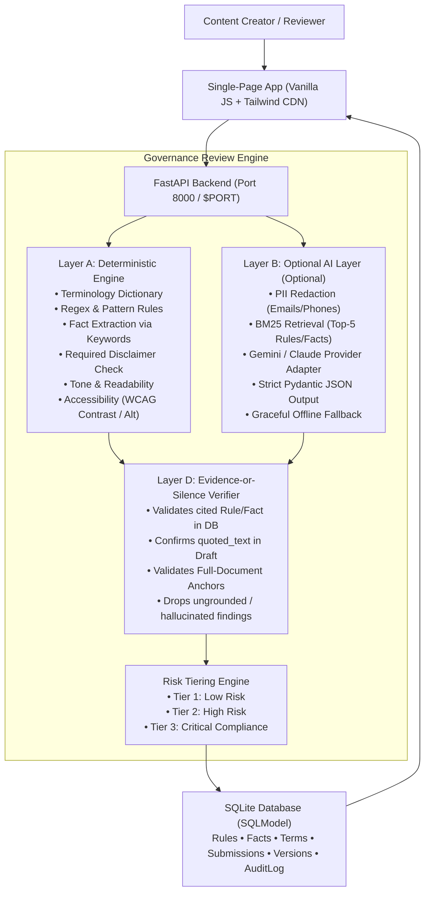

# BrandCanon 🛡️

[](https://render.com/deploy?repo=https://github.com/lohith459/brandcanon)
[](LICENSE)
[](https://python.org)

**BrandCanon** is an intelligent pre-publication brand governance platform designed for the Inkloom AI problem statement. It reviews marketing copy, blog posts, and regulatory disclosures against approved guidelines, verified facts, preferred terminology, and visual/accessibility assets **before publication**.

It pinpoints exact issues, cites the verified rule or factual ceiling behind each violation, suggests intent-preserving fixes, and routes content through a human-governed approval queue. **AI never approves or publishes anything.**

---

## ⚡ 60-Second Quickstart (Try the Demo)

A judge opening BrandCanon needs **no login**, **no API keys**, and **no setup**:
1. Click **"⚡ Try the demo"** in the top navigation bar.
2. The system loads the pre-seeded worked example:
   > *"Guaranteed 12% returns!! Join 50,000+ investors on FinEdge Pro. It's FREE forever!"*
3. The review engine immediately displays:
   - **⚠️ Tier 3 (Critical Compliance)** risk badge.
   - Exact highlighted spans for guaranteed returns (`CMP-004`), retired product name `FinEdge Pro` (`TRM-011`), user count exceeding verified ceiling (`F-017`), free-tier overpromise (`F-022`), exclamation formatting (`TON-003`), and missing statutory disclaimer (`DISC-002`).
4. Click **Accept Fix** on violations → click **Apply Accepted Fixes**.
5. The system applies fixes backwards safely, creates **Version 2**, runs an automatic re-review, and presents a **tracked-changes visual diff**.
6. Switch demo role to **Compliance Reviewer** to approve the Tier 3 submission (demonstrating server-side role gating where Managers are blocked).

---

## 🏗️ Architecture



---

## 📊 Evaluation Benchmark Results

The review engine is evaluated against a 30-piece labelled test corpus (`evaluation/corpus.json`) that is **team-authored and seeded** with realistic planted violations across all categories:

| Metric | Score |
|---|---|
| **Overall Precision** | **100.00%** |
| **Overall Recall** | **89.47%** |
| **Overall F1 Score** | **94.44%** |
| **Citation-Integrity Rate** | **100.00%** (Evidence-or-Silence) |

### Category Breakdown
- **Accessibility**: 100% Precision | 100% Recall
- **Compliance**: 100% Precision | 85.7% Recall
- **Facts**: 100% Precision | 100% Recall
- **Terminology**: 100% Precision | 100% Recall
- **Tone**: 100% Precision | 100% Recall
- **Clean Pieces (Negatives)**: 100% Precision | 100% Specificity (0 false positives)

To run the evaluation script:
```bash
python evaluation/run_eval.py
```

---

## 🚀 Local Development Setup

### Prerequisites
- Python 3.11+
- Git

### Installation
```bash
# 1. Clone repository
git clone https://github.com/lohith459/brandcanon.git
cd brandcanon

# 2. Create virtual environment
python -m venv .venv

# On Windows:
.\.venv\Scripts\activate
# On Linux/macOS:
source .venv/bin/activate

# 3. Install dependencies
pip install -r requirements.txt

# 4. Run automated test suite
pytest tests/ -v

# 5. Start development server
uvicorn app.main:app --reload --port 8000
```
Open **`http://localhost:8000`** in your browser. The database seeds automatically on startup with the FinEdge brand canon.

---

## 🐳 Docker & Cloud Deployment

### 1-Click Deploy to Render
You can deploy BrandCanon to Render for free using the button below or by connecting your GitHub fork:

[](https://render.com/deploy?repo=https://github.com/lohith459/brandcanon)

### Manual Docker Build
```bash
# Build production image
docker build -t brandcanon .

# Run container (reads $PORT dynamically)
docker run -p 8000:8000 -e PORT=8000 brandcanon
```

> [!TIP]
> **Free Tier Cold Starts & Uptime Monitoring**: Free tier containers on Render spin down after 15 minutes of inactivity. To prevent a 30-second cold start when judges inspect your public URL, set up a free uptime monitor (e.g., [UptimeRobot](https://uptimerobot.com) or [Cron-Job.org](https://cron-job.org)) that sends an HTTP GET request to `/health` every 10 minutes.

---

## 🔒 Security & Privacy Features

- **Zero-Key Offline Guarantee**: The system runs 100% offline out-of-the-box without requiring any external AI API keys.
- **Confidential Mode Toggle**: A persistent UI toggle that strictly suppresses outbound network calls to external LLMs.
- **Automatic PII Redaction**: Regex scrubbing strips email addresses (`[REDACTED_EMAIL]`) and phone numbers (`[REDACTED_PHONE]`) before external calls.
- **File Upload Safeguards**: Hard 2 MB size ceiling and extension allowlist (`.txt`, `.md`, `.docx`, `.pdf`, `.html`). Rejects executables and archives.
- **In-Memory Rate Limiting**: Built-in sliding window rate limiter protects sensitive review endpoints against request floods.
- **Strict Role Permissions**: Server-side validation on `X-Demo-Role`. **Tier 3 critical compliance submissions strictly require Compliance Reviewer sign-off.**

---

## ⚙️ Environment Variables

| Variable | Default | Description |
|---|---|---|
| `PORT` | `8000` | Port for the Uvicorn web server (automatically set by Render/Railway). |
| `DATABASE_URL` | `sqlite:///./brandcanon.db` | Relational database connection string. |
| `GEMINI_API_KEY` | `None` | (Optional) Enables Google Gemini 1.5 Flash semantic review. |
| `ANTHROPIC_API_KEY` | `None` | (Optional) Enables Anthropic Claude 3 Haiku semantic review. |
| `RATE_LIMIT_PER_MINUTE` | `60` | Max sensitive requests per minute per IP. |

---

## 📁 Repository Structure

```
brandcanon/
├── app/
│   ├── main.py              # Application entrypoint, middlewares, lifespan
│   ├── config.py            # Environment settings and file constraints
│   ├── database.py          # SQLModel engine and session dependency
│   ├── models/              # Rule, Fact, Term, Asset, Submission, Version, Finding
│   ├── core/                # Roles, Parsers, PII redaction, Diff, Contrast calculator
│   ├── engine/              # Layer A deterministic checks, Layer B AI, Layer D verifier
│   ├── api/                 # Endpoints: submissions, review, workflow, canon, health
│   ├── seed/                # FinEdge brand canon and 3 sample drafts
│   └── static/              # Single-page app (index.html, app.js, review_ui.js, custom.css)
├── evaluation/
│   ├── corpus.json          # 30-piece labelled test corpus
│   └── run_eval.py          # Benchmark evaluation script
├── tests/                   # 29 automated test cases across 8 suites
├── Dockerfile               # Container build configuration
├── render.yaml              # Render 1-click infrastructure blueprint
├── requirements.txt         # Lightweight dependencies
├── DECISIONS.md             # Architecture decision log
├── FEATURES.md              # Completed vs planned matrix
├── TECH.md                  # In-depth technical breakdown
├── CHANGES_FROM_PLAN.md     # Honest architectural deviations
├── ROUND3.md                # Specifications for Round 3 improvements
├── AI_DISCLOSURE.md         # Transparency disclosure
└── LICENSE                  # MIT License
```

---

## ⚖️ Limitations & Disclosures

- **Demo Roles**: For instant evaluation without signup friction, user personas are selected via the UI role dropdown (`X-Demo-Role`). Production deployments should integrate enterprise SSO (Okta / SAML / OIDC).
- **BM25 Scope**: Semantic retrieval uses BM25 Okapi rather than dense neural embeddings to minimize container footprint and prevent cold-start latency.
- **Browser File Extraction**: PDF and Word text extraction runs server-side with strict 2MB bounds. OCR on rasterized image-only PDFs is not included in the lightweight MVP.

---

## 📄 License
Released under the [MIT License](LICENSE).
